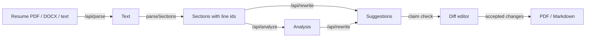

# Fitted

Tailor your resume to a job description without making anything up.

Fitted compares your resume with a job, scores the match, suggests changes line by line, and writes a cover letter. You accept, reject or edit every change, then export a clean PDF.

**Live demo:** _add the Vercel URL here after deploying_ · No sign-up. Press **Try sample** to see a full run without using any AI calls.

<!-- Add docs/demo.gif: record the sample flow (about 20 seconds). -->

## Features

- **Match analysis** that streams in: score, skills you show, skills you're missing, keyword gaps, seniority fit.
- **Line-by-line rewrite** with a word-level diff. Accept, reject or edit each change, or accept all safe changes in a section.
- **No made-up claims.** Suggestions that add a number, skill or name not found in your resume are marked "Check this" and are never accepted in bulk.
- **Cover letter** in three tones, streamed and editable.
- **Export** to an ATS-friendly PDF or copy as Markdown.
- **Private by default.** Runs are saved in your browser (IndexedDB), not on a server.

## How it works



- **Structured output.** Each AI route sends a JSON schema generated from the same Zod schema the browser uses (`lib/schemas.ts`). The server parses partial JSON as it streams and forwards it as newline-delimited JSON events, so the UI fills in field by field.
- **Validation everywhere.** Request bodies and final AI output are checked with Zod. An invalid response is retried once.
- **Upload checks.** Resumes can be PDF or DOCX, up to 4 MB (under Vercel's request size limit) and 20 PDF pages. The server checks the file's real PDF or DOCX signature, not just its name or type.
- **Cost controls.** The demo is rate limited through Upstash Redis: 15 AI calls per IP per day, plus a global cap of 150 AI calls per day across all visitors. If the limiter itself errors, AI routes fail closed and show a "busy" message instead of running unmetered. When a visitor closes the tab, the in-flight Claude request is aborted. If you deploy your own copy, also set a monthly spend limit on your Anthropic key as the final backstop.
- **Mock mode.** `MOCK_AI=1` replays `fixtures/sample-run.json`, so tests and CI never call the paid API.

## How Fitted avoids made-up claims

1. The prompts forbid inventing employers, titles, dates, metrics, tools or skills, and tell the model to treat the resume and job text as data, not instructions.
2. The model marks any suggestion that adds a checkable fact.
3. `lib/ai/verify.ts` checks every suggestion again without the model: any number, known skill, or capitalized name that is not in your original resume marks it "Check this".
4. Marked suggestions are never accepted by "Accept all safe". You decide.

## Stack

Next.js 16 (App Router) · React 19 · TypeScript · Tailwind CSS v4 · Radix UI · Anthropic TypeScript SDK (Claude Opus 5.5) · Zod · unpdf · mammoth · @react-pdf/renderer · Upstash · Vitest · Playwright · axe-core · GitHub Actions · Vercel

## Run locally

```bash
git clone https://github.com/AnchalRana21/fitted.git
cd fitted
npm install
cp .env.example .env.local   # add ANTHROPIC_API_KEY, or set MOCK_AI=1
npm run dev
```

| Variable | Required | Purpose |
|---|---|---|
| `ANTHROPIC_API_KEY` | For real AI calls | Without it, only the sample works |
| `ANTHROPIC_MODEL` | No | Defaults to `claude-opus-5-5` |
| `UPSTASH_REDIS_REST_URL`, `UPSTASH_REDIS_REST_TOKEN` | No | Turns on rate limiting (off when empty, for local development) |
| `MOCK_AI` | No | `1` replays the fixture instead of calling the API |

## Tests

```bash
npm test          # unit tests (Vitest)
npm run test:e2e  # end-to-end + accessibility (Playwright, mock AI)
```

## Limits

- Scanned PDFs have no text layer; paste the text instead.
- Each line of the resume is treated as one item, so a bullet that wraps onto two lines in a PDF may be split in two. Fix it in the text box before tailoring.
- The PDF export uses built-in fonts, so a resume with characters outside Latin-1 (for example Devanagari names, ₹, ≥ or emoji) can't be exported to PDF. Fitted detects this and offers Copy as Markdown instead.
- Uploads are limited to 4 MB and 20 PDF pages. Longer files need to be pasted as text.

## License

MIT
